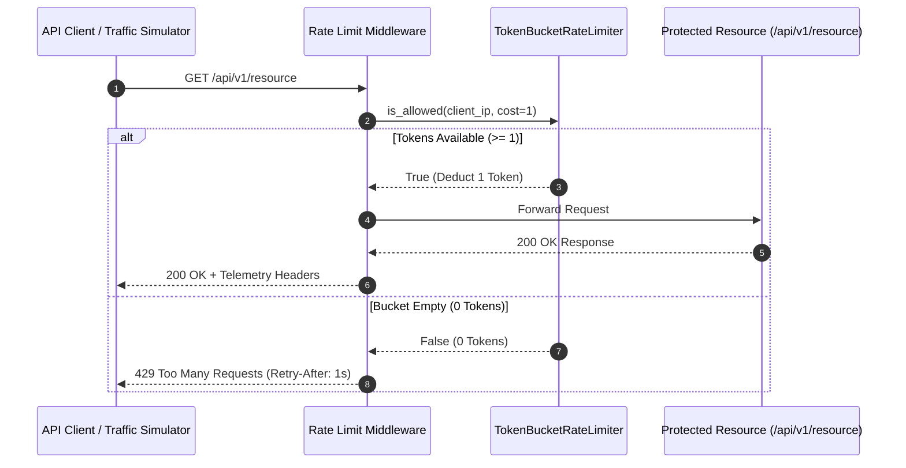

# 🛡️ API Rate Guard (Token Bucket Resiliency Gateway)

A high-performance, in-memory API rate limiting and traffic throttling gateway engineered using Python, FastAPI, and the Token Bucket Algorithm.

---

## 🚀 Key Highlights

- **Token Bucket Core:** Implements fractional token replenishment based on elapsed time differentials.

- **Traffic Throttling Middleware:** Intercepts incoming HTTP requests, enforces burst thresholds, and emits standard `429 Too Many Requests` responses.

- **RFC-Compliant Telemetry:** Appends `X-RateLimit-Limit`, `X-RateLimit-Remaining`, and `Retry-After` headers to all responses.

- **Resiliency Verification:** Includes a burst traffic simulator verifying capacity bounds and recovery dynamics.

---

## 🛠️ Tech Stack

- Python 3.10+

- FastAPI & Uvicorn

- HTTPX (Concurrent Traffic Simulation)

- Rich (Terminal Telemetry Visualization)

---

## 📊 System Architecture & Traffic Flow


---

## 🖥️ Execution Telemetry Output

```text

Rate Limiter Execution Telemetry
+-------+------------+-------------+-------------+---------------+
| Seq # | Timestamp  | Status Code | Tokens Left | Audit Outcome |
+-------+------------+-------------+-------------+---------------+
|   1   |  21:49:45  |     200     |      4      |    PASSED     |
|   2   |  21:49:45  |     200     |      3      |    PASSED     |
|   3   |  21:49:45  |     200     |      2      |    PASSED     |
|   4   |  21:49:45  |     200     |      1      |    PASSED     |
|   5   |  21:49:45  |     200     |      0      |    PASSED     |
|   6   |  21:49:45  |     429     |      0      | BLOCKED (429) |
|   7   |  21:49:46  |     429     |      0      | BLOCKED (429) |
|   8   |  21:49:46  |     429     |      0      | BLOCKED (429) |
|   9   |  21:49:46  |     429     |      0      | BLOCKED (429) |
|  10   |  21:49:46  |     429     |      0      | BLOCKED (429) |
+-------+------------+-------------+-------------+---------------+

```
---

## ⚙️ How to Run

### 1. Install dependencies:
```
pip install -r requirements.txt
```

### 2. Start the gateway server:
```
uvicorn app:app --port 8000 --reload
```

### 3. Execute the burst traffic simulator:
```
python main.py
```


